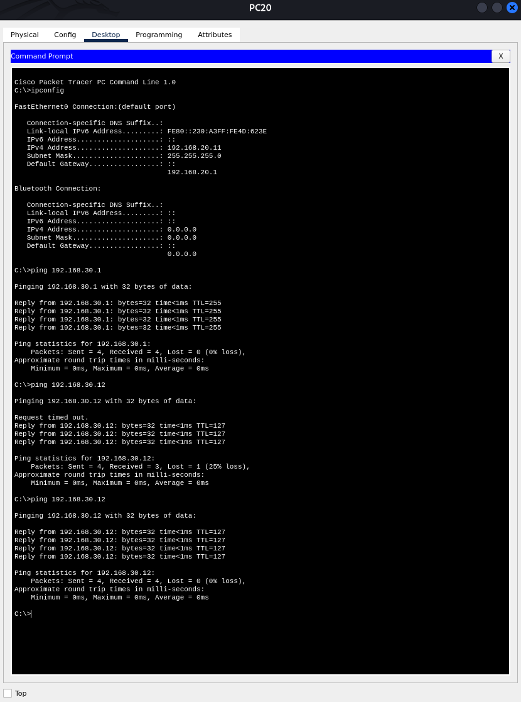
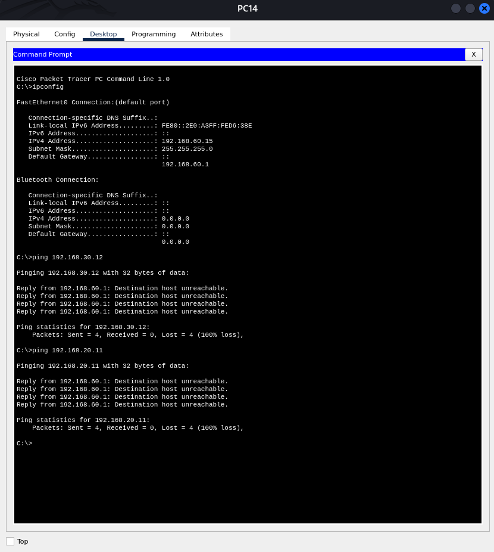
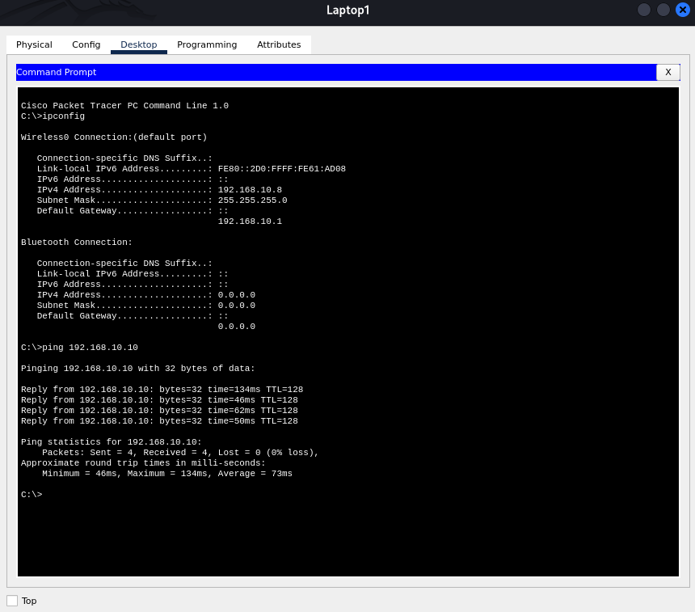
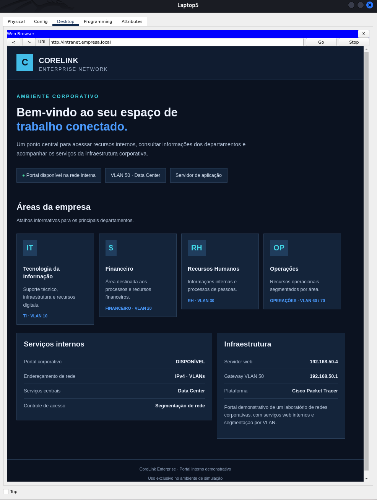

# 🧪 Network Connectivity and Security Tests

This directory documents the connectivity and security tests performed on the **Enterprise Network Defense-in-Depth** project in Cisco Packet Tracer.

## 📋 Test Plan

| Test | Expected Result | Evidence |
|---|---|---|
| Finance VLAN 20 → HR VLAN 30 | Ping succeeds when permitted by the configured policies. | `screenshots/finance-to-hr.png` |
| Operations VLAN 60/70 → HR VLAN 30 | Ping is blocked by the applicable access control policy. | `screenshots/operations-to-hr-blocked.png` |
| PC40 → TI laptops | Connectivity succeeds between the wired workstation and wireless clients. | `screenshots/ti-connectivity.png` |
| Internal application server | The internal portal or another configured service responds successfully. | `screenshots/internal-portal.png` |

## 🎯 Purpose

These tests validate inter-VLAN routing, access control policies, wireless connectivity, and centralized network services.

> **Note:** Expected results must be confirmed through actual tests. Evidence should be added only after the corresponding behavior has been verified in Cisco Packet Tracer.

---

## ✅ Test Evidence: Finance to HR Connectivity

**Test ID:** `NET-TEST-01`

**Source:** PC20 — Finance, VLAN 20  
**Source IP:** `192.168.20.11`  
**Destination:** PC31 — HR, VLAN 30  
**Destination IP:** `192.168.30.12`

**Command:**

```text
ping 192.168.30.12
```

**Result:** Successful — 4 packets received, 0% packet loss on the final attempt.

**Conclusion:** Inter-VLAN connectivity between Finance and HR was successfully verified in Cisco Packet Tracer.

### Screenshot



---

## 🔒 Remaining Tests

The following evidence will be added after each test has been executed and verified:

- **NET-TEST-02:** Confirm that traffic from Operations VLAN 60 or 70 to HR VLAN 30 is blocked by the configured ACL.
- **NET-TEST-03:** Verify communication between PC40 and the TI laptops over the wireless network.
- **NET-TEST-04:** Access the internal application portal and confirm that the service responds successfully.

---

## NET-TEST-02 — Inter-VLAN Traffic Filtering for Operational Network Security

**Security mechanism:** Access Control Lists (ACLs) configured on the Cisco Catalyst 3560 multilayer switch.

- **Source:** PC14 — Operational VLAN 60 (`192.168.60.15`)
- **Restricted destinations:**
  - Finance VLAN 20 (`192.168.20.11`)
  - HR VLAN 30 (`192.168.30.12`)
- **Test method:** ICMP connectivity verification using `ping`.
- **Observed result:** Both connection attempts failed, returning `Destination host unreachable` with 100% packet loss.
- **Security objective:** Enforce network segmentation by restricting traffic from the Operational VLAN to sensitive corporate departments, reducing unauthorized access to Finance and HR resources.
- **Enforcement point:** Cisco Catalyst 3560 multilayer switch, where inter-VLAN routing and ACL-based traffic filtering are implemented.

### Screenshot



**Security validation:** The results confirm that traffic from the Operational VLAN to Finance and HR is blocked by the ACL security policies configured on the Cisco Catalyst 3560 multilayer switch.

---

---

## NET-TEST-03 — TI Wireless Connectivity Test

This test verifies communication between a wireless TI laptop and a wired workstation within VLAN 10.

- **Source:** Laptop1 — TI VLAN 10 (`192.168.10.8`)
- **Destination:** PC40 — TI VLAN 10 (`192.168.10.10`)
- **Test method:** ICMP connectivity verification using `ping`.
- **Observed result:** Successful communication, with 4 packets received and 0% packet loss.
- **Security objective:** Verify wireless connectivity to the wired TI network while maintaining VLAN segmentation.

### Screenshot



**Conclusion:** Laptop1 successfully reached PC40 over the network, confirming connectivity between the wireless and wired devices within VLAN 10.

---

---

## NET-TEST-04 — Internal Web Portal

This test validates access to the corporate web portal hosted on the internal web server.

- **Client:** Laptop5 — TI network
- **Portal URL:** `http://intranet.empresa.local`
- **Web server:** `192.168.50.4`
- **Hosting network:** Data Center — VLAN 50
- **Observed result:** The CoreLink corporate portal loaded successfully in the Packet Tracer web browser.

### Screenshot



### Conclusion

The test confirms that the internal web server is operational and that the corporate portal is accessible from the TI network using its configured DNS name. This demonstrates successful access to an internal web application hosted in the Data Center VLAN.
