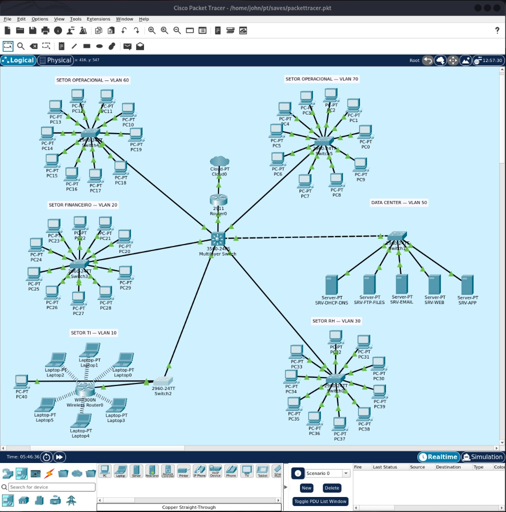

# 🌐 Network Topology

This directory contains the network diagram and Cisco Packet Tracer simulation for the **Enterprise Network Defense-in-Depth** project.

## 🗺️ Network Diagram

The diagram illustrates the corporate network architecture, including departmental VLANs, core and access switches, the edge router, wireless connectivity, and the centralized Data Center.

## 📁 Project Files

| File | Description |
|---|---|
| `enterprise-network-topology.png` | Complete visual overview of the corporate network. |
| `enterprise-network.pkt` | Editable Cisco Packet Tracer simulation. |

